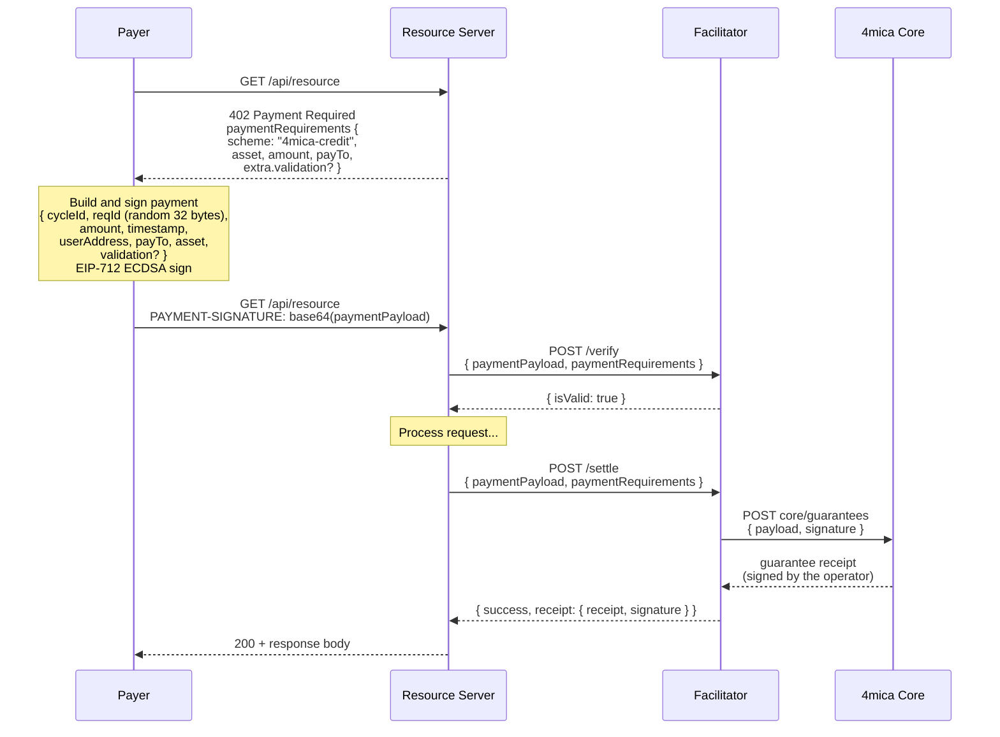
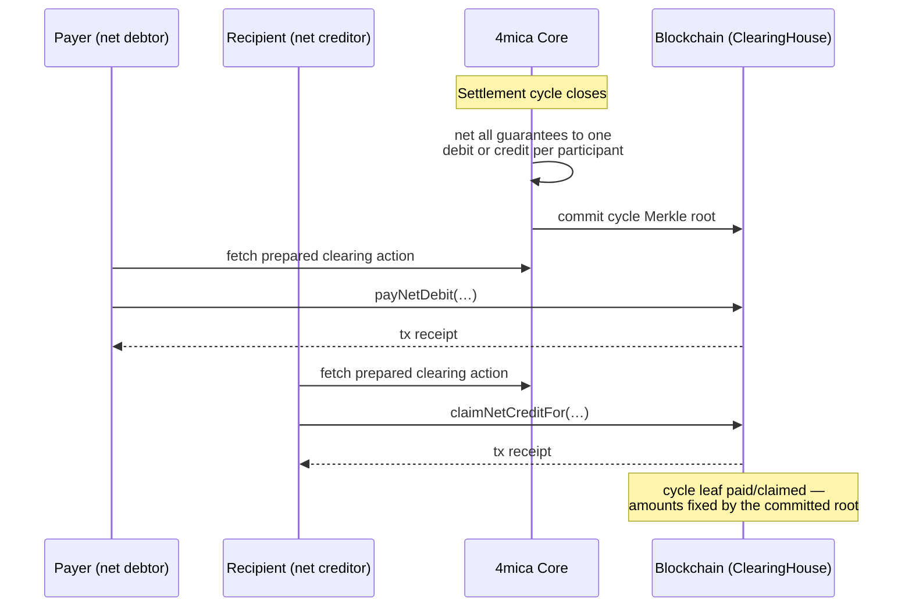

# x402-4mica Facilitator

<p align="center">
  <a href="https://github.com/4mica-network/x402-4mica/actions/workflows/ci.yml">
    
  </a>
  <a href="LICENSE">
    
  </a>
</p>

A facilitator for the x402 protocol that runs the 4mica credit flow. Resource servers call it to
validate payment payloads against their `paymentRequirements` and settle by returning the
operator's signed guarantee receipt to the recipient.


**Contents**
- [How to use the system](#how-to-use-the-system)
- [Gasless deposits](#gasless-deposits)
- [Integrate from x402](#integrate-from-x402)
- [Run your own facilitator](#run-your-own-facilitator)

## How to use the system

### Quick integration (resource servers)

- Configure the 4mica facilitator (for example `https://x402.4mica.xyz/`). Your `402 Payment Required` responses should advertise `scheme = "4mica-credit"`, a supported `network`, and set `payTo` / `asset` (an address from core's `GET /core/tokens` for that network) / `amount` (`maxAmountRequired` under x402 v1). To gate the payment on a validation outcome, also advertise `paymentRequirements.extra.validation = { validator, subject, deadline?, params? }`.
- Clients sign a payment straight from your `paymentRequirements` — no round-trip to you or the facilitator first — producing the x402 `paymentPayload` that they send on the retried request for the protected resource. You never construct this payload yourself; you only need to validate and consume it.
- When a request arrives with a payment payload, send it together with the original `paymentRequirements` to the facilitator's `/verify` and `/settle` endpoints. Use `/verify` as an optional preflight check before doing work, and `/settle` once you are ready to accept credit: 4mica core issues the guarantee in the open settlement cycle for that asset, and the facilitator returns the operator's signed receipt. When core refuses, pass the `/settle` response back to the payer: its `errorReason` and `extra.details` say what to do. That is the whole integration — there are no endpoints for you to implement.

### Quick integration (clients)

- Python SDK:

  ```bash
  pip install sdk-4mica
  ```

  ```python
  import asyncio, base64, json
  from fourmica_sdk import Client, ConfigBuilder, X402Flow, X402PaymentRequired

  payer_key = "0x..."    # wallet private key
  user_address = "0x..." # address to embed in the claims

  async def main():
      cfg = (
          ConfigBuilder()
          .wallet_private_key(payer_key)
          .rpc_url("https://base.sepolia.api.4mica.xyz/")
          .build()
      )
      client = await Client.connect(cfg)
      flow = X402Flow.from_client(client)

      # The 402 response carries the challenge in its `payment-required` header (base64 JSON)
      challenge = X402PaymentRequired.from_raw(json.loads(base64.b64decode(header)))
      accepted = next(a for a in challenge.accepts if a.scheme == "4mica-credit")

      payment = await flow.sign_payment_v2(challenge, accepted, user_address)
      headers = {"PAYMENT-SIGNATURE": payment.header}  # retry header (decode to paymentPayload for /verify)
      await client.aclose()

  asyncio.run(main())
  ```

- TypeScript SDK:

  ```bash
  npm install @4mica/sdk
  ```

  ```ts
  import { Client, ConfigBuilder, X402Flow, X402PaymentRequired } from "@4mica/sdk";

  async function run() {
    const cfg = new ConfigBuilder().walletPrivateKey("0x...").network("base-sepolia").build();
    const client = await Client.connect(cfg);
    const flow = X402Flow.fromClient(client);

    // The 402 response carries the challenge in its `payment-required` header (base64 JSON).
    const challenge = X402PaymentRequired.fromRaw(
      JSON.parse(Buffer.from(header, "base64").toString("utf8"))
    );
    const accepted = challenge.accepts.find((a) => a.scheme === "4mica-credit")!;

    const payment = await flow.signPaymentV2(challenge, accepted, client.signerAddress);
    const headers = { "PAYMENT-SIGNATURE": payment.header }; // decode to paymentPayload for /verify
    await client.aclose();
  }

  run();
  ```

- Rust SDK: `cargo add sdk-4mica` and call
  `X402Flow::sign_payment_v2(payment_required, accepted, user_address)` to obtain the same
  `payment.header` for the retry request.
- x402 v1 (JSON body with `accepts`, `X-PAYMENT` retry header) is still served. Call the v1
  sibling — `signPayment(requirements, userAddress)` / `sign_payment(requirements, user_address)` —
  with the v1 requirements entry instead.
- With `@4mica/x402` and `@x402/fetch` none of this is hand-written:
  `wrapFetchWithPaymentFromConfig(fetch, { schemes: [{ network: "eip155:84532", client: await FourMicaEvmScheme.create(account) }] })`
  handles the 402, the signing and the retry (see `packages/typescript/x402/README.md`).

### Demo example

You can pair the client with `examples/server/mock_paid_api.py`, a FastAPI server that simulates a
paywalled endpoint. Start it with `python examples/server/mock_paid_api.py` (set `PORT` to override
the default `9000`). The mock resource will call the facilitator's `/verify` endpoint (defaulting to
`https://x402.4mica.xyz/`; override with `FACILITATOR_URL`) whenever it receives a payment payload
(the mock speaks x402 v1, so it reads the `X-PAYMENT` header).

The bundled Rust example shows how to sign a payment
header with `sdk-4mica`:

```bash
# requires PAYER_KEY, USER_ADDRESS, RESOURCE_URL and ASSET_ADDRESS
cargo run --example rust_client
```

The example will read environment variables from `examples/.env` (or a root `.env`) if present. A
Python counterpart lives in `examples/python_client/client.py` (install deps with `pip install -r
examples/python_client/requirements.txt`). A TypeScript version lives in `examples/ts_client`
(`npm install && npm start`).

### Payment payload schema (v2)

`paymentPayload` is a JSON envelope, sent base64-encoded in the `PAYMENT-SIGNATURE` header. The
requirements entry the payer accepted travels under `accepted`, an optional `resource` block may
accompany it, and the signed payment inside is `"version": "v1"` — the x402 protocol version is
decoupled from the payment payload version. Validation gating travels as `extra.validation` on the
requirements and as the nested `validation` object inside the signed payment. The facilitator
derives the expected chain id from the CAIP-2 payment network.

```json
{
  "x402Version": 2,
  "accepted": {
    "scheme": "4mica-credit",
    "network": "eip155:84532",
    "amount": "<decimal or 0x value>",
    "payTo": "<0x-prefixed checksum string>",
    "asset": "<0x-prefixed checksum string>",
    "extra": {
      "validation": {
        "validator": "<0x-prefixed checksum string>",
        "subject": "<subject identifier>",
        "deadline": 1716503600
      }
    }
  },
  "payload": {
    "payload": {
      "version": "v1",
      "user_address": "<0x-prefixed checksum string>",
      "recipient_address": "<0x-prefixed checksum string>",
      "cycle_id": "<0x-prefixed 32-byte settlement cycle id>",
      "req_id": "<0x-prefixed 32-byte value>",
      "amount": "<0x-prefixed u256 value>",
      "asset_address": "<0x-prefixed checksum string>",
      "timestamp": 1716500000,
      "salt": "<0x-prefixed 32-byte value>",
      "validation": {
        "validator": "<0x-prefixed checksum string>",
        "subject": "<subject identifier>",
        "deadline": 1716503600
      }
    },
    "signature": "<0x-prefixed EIP-712 wallet signature>"
  },
  "resource": { "url": "/your/resource" }
}
```

`cycle_id` is the asset's active settlement cycle, which the SDK reads from core. `req_id` and
`salt` are random 32-byte values the client mints locally — uniqueness is all core asks of
`req_id`. When the requirements carry `extra.validation`, the signed payment additionally embeds the
same requirement as a nested `validation` object
(`{ "validator", "subject", "deadline"?, "params"? }`), and the facilitator cross-checks both
sides.

### Payment payload schema (v1, legacy)

x402 v1 changes only the envelope, not the signed payment: it is flat, names `scheme` and `network`
directly, and is sent base64-encoded in the `X-PAYMENT` header:

```json
{
  "x402Version": 1,
  "scheme": "4mica-credit",
  "network": "eip155:84532",
  "payload": {
    "payload": {
      "version": "v1",
      "user_address": "<0x-prefixed checksum string>",
      "recipient_address": "<0x-prefixed checksum string>",
      "cycle_id": "<0x-prefixed 32-byte settlement cycle id>",
      "req_id": "<0x-prefixed 32-byte value>",
      "amount": "<0x-prefixed u256 value>",
      "asset_address": "<0x-prefixed checksum string>",
      "timestamp": 1716500000,
      "salt": "<0x-prefixed 32-byte value>"
    },
    "signature": "<0x-prefixed EIP-712 wallet signature>"
  }
}
```

The facilitator enforces that:

- `scheme` / `network` match both `/supported` and the resource server's requirements.
- `payTo` equals the signed `recipient_address`.
- `asset` equals the signed `asset_address`.
- For V1, `maxAmountRequired` must match the signed `amount` exactly.
- For V2, `amount` must match the signed `amount` exactly.
- When `paymentRequirements.extra.validation` is present, the signed payment must carry the same
  `validation` requirement (`validator`, `subject`, optional `deadline` and `params`) — the
  facilitator cross-checks both sides.
- On `/settle`, the receipt core returns must be signed by core's `guarantee_signer` under the
  GuaranteeRegistry's EIP-712 domain, and must describe exactly the payment the payer signed.

### HTTP API

- `GET /supported` – returns all `(scheme, network)` tuples the facilitator can service (4mica and,
  if configured, any additional `exact` flows).
- `GET /health` – liveness probe. Returns `{ "status": "ok" }`, plus relayer and deposit detail
  when gas sponsorship is configured:
  ```json
  {
    "status": "ok",
    "relayers": [
      { "network": "eip155:84532", "address": "0x…", "balanceWei": "…", "belowFloor": false }
    ],
    "deposits": { "sponsored": 12, "rejected": 3, "throttled": 1 },
    "withdrawals": { "sponsored": 4, "rejected": 0, "throttled": 0 }
  }
  ```
  Counters are per sponsored action, so a rising `rejected` names which one is being abused.
  `status` is `degraded` when any relayer is at or below `X402_DEPOSIT_MIN_RELAYER_BALANCE_WEI`, or
  when its balance cannot be read — so a plain HTTP check is enough to alert on. A rising
  `throttled` distinguishes an abuse attempt from a merely misconfigured client. Balances are
  cached for 15s, so polling this endpoint does not amplify into RPC load.
- `POST /verify`
  - Request: `{ "x402Version": 1|2, "paymentPayload": { ... }, "paymentRequirements": { ... } }`.
  - Response: `{ "isValid": true, "payer" }` or `{ "isValid": false, "invalidReason",
    "invalidMessage", "extra": { "retryable" } }`. See [Errors](#errors).
- `POST /settle`
  - Request: same shape as `/verify`.
  - Response: for 4mica, `{ "success": true, "payer", "transaction": "", "network",
    "extra": { "receipt": { "receipt", "signature" } } }`. There is no transaction: the guarantee
    is the settlement. On failure, `{ "success": false, "errorReason", "errorMessage",
    "transaction": "", "network", "extra": { "retryable", "details"? } }`. Hand a refused
    guarantee back to the payer: `invalid_4mica_credit_checkpoint_required`, for example, means
    the payer must submit a checkpoint to core before more payments are accepted, and
    `invalid_4mica_credit_cycle_mismatch` means it must re-sign for the active cycle. When
    delegating to the `exact` facilitator the response is upstream x402's.
    If `X402_DEBIT_URL` is set, debit requests are proxied to the configured x402-rs
    facilitator, allowing clients to follow the x402 debit flow unchanged.
- `POST /deposit` and `POST /deposit/verify` – gasless deposits; see below. Available only when a
  relayer is configured, otherwise every request is refused with `sponsorship_unavailable`.
- `POST /withdraw` and `POST /withdraw/verify` – gasless withdrawals; see below. Same availability
  rule as `/deposit`.
- `POST /clearing/claim` and `POST /clearing/claim/verify` – sponsored net-credit claims; see
  below. Same availability rule as `/deposit`.
- `POST /clearing/pay` and `POST /clearing/pay/verify` – sponsored net-debit payments; see below.
  Same availability rule as `/deposit`.

### Errors

Every endpoint reports a failure the way x402 does: a machine-readable reason, a human message,
and 4mica's additions under `extra`.

```jsonc
// verify endpoints
{ "isValid": false, "invalidReason": "…", "invalidMessage": "…", "extra": { "retryable": false } }
// /settle and the sponsored actions
{ "success": false, "errorReason": "…", "errorMessage": "…", "extra": { "retryable": false, "details": { … } } }
```

Branch on the reason, not on the message. `extra.retryable` is true only when repeating the identical
request later may succeed (throttling, an unreachable chain or core). `extra.details` appears when
the message alone is not enough to act on. A failure after broadcasting carries its `transaction`.

Reasons x402 defines:

| Reason | Meaning |
| --- | --- |
| `invalid_payload` | The payment or request is malformed, or core refused it without a more specific reason |
| `invalid_payment_requirements` | The resource server's requirements are malformed |
| `invalid_x402_version` / `unsupported_scheme` / `invalid_network` | Not something this facilitator serves |
| `insufficient_funds` | The payer lacks the collateral or tokens for this payment |
| `settlement_pending` | Broadcast, but the outcome is unknown: check `transaction` on-chain, do **not** retry |
| `invalid_transaction_state` | Mined and reverted, so gas was spent |
| `unexpected_verify_error` / `unexpected_settle_error` | Something failed on our side |

Reasons for the `4mica-credit` scheme, prefixed `invalid_4mica_credit_` as x402 schemes do:

| Reason | Meaning |
| --- | --- |
| `…_recipient_mismatch` / `…_asset_mismatch` / `…_amount_mismatch` | The payment differs from the requirements |
| `…_validation_mismatch` | The signed validation requirement differs from the advertised one |
| `…_validator_not_allowed` | The validator is not one core accepts |
| `…_checkpoint_required` | The payer must submit a checkpoint to core first |
| `…_cycle_mismatch` | The payment names a cycle that is no longer active; re-sign for the active one |
| `…_timestamp_not_past_cutoff` / `…_future_timestamp` / `…_stale_timestamp` | Re-sign with a fresh timestamp |
| `…_payer_not_registered` / `…_payer_suspended` | Core does not accept payments from this payer |
| `…_duplicate_request` | The request id was already used for a different payment |

Reasons for the sponsored endpoints:

| Reason | Meaning |
| --- | --- |
| `sponsorship_unavailable` | No relayer for this facilitator or the requested network |
| `unsupported_transfer_method` | `assetTransferMethod` is neither `eip3009` nor `permit2` |
| `permit2_allowance_required` | Payer must approve Permit2 first; see [Gasless deposits](#gasless-deposits) |
| `authorization_expired` / `authorization_not_yet_valid` | Outside the authorization's validity window |
| `invalid_signature` | The signature is malformed or does not recover to the declared signer |
| `nonce_already_used` | Authorization already redeemed |
| `simulation_reverted` | The transaction would revert; the message carries the decoded contract error |
| `gas_ceiling_exceeded` | Estimated gas above the sponsored ceiling |
| `clearing_action_unavailable` / `clearing_action_mismatch` | Core could not supply the cycle's terms |
| `chain_unavailable` / `broadcast_failed` | The chain could not be reached; nothing was submitted |
| `rate_limited` / `duplicate_in_flight` / `relayer_underfunded` | Throttled; retry later |

### Sponsored net-credit claims

A net creditor in a committed clearing cycle is owed money on-chain, but collecting it costs a
transaction — and a creditor who never held native gas cannot send one. These endpoints let the
facilitator's relayer submit `claimNetCreditFor` for them:

```jsonc
{
  "cycleId": "eth:1800000000",   // as core names it: text id or the 0x-prefixed on-chain hash
  "creditor": "0x…",
  "network": "eip155:…"          // optional; defaults to the first configured network
}
```

`/clearing/claim` answers with `{ "success": true, "transaction", "network", "creditor", "cycleId",
"amount" }`; `/clearing/claim/verify` answers with `{ "isValid": true }` and spends no gas. Both
report failures as described in [Errors](#errors).

The request carries no signature and needs none: the ClearingHouse pays the address the cycle's
committed Merkle leaf names, for the amount that leaf fixes, so a submitter can neither redirect
nor inflate the payout. Everything the transaction depends on — the ClearingHouse address, the
amount, the proof — is resolved from core (which is why the facilitator's auth wallet must be able
to read clearing actions), never taken from the request; the caller only names *which* claim to
submit. `amount` echoes the committed net credit — in a `Shortfall` cycle the on-chain payout is a
pro-rata fraction of it.

Throttling is configured separately (`X402_CLAIM_*`), and concurrent submissions for the same
cycle are deduplicated so only one pays gas — the other would revert as `AlreadyClaimed`.

### Sponsored net-debit payments

The debtor's side of the same cycle. Paying a net debit pulls money *out of* the debtor's wallet,
so unlike a claim it carries the debtor's signature — an EIP-3009 `receiveWithAuthorization` the
facilitator submits via `payNetDebitWithAuthorization`, or, for tokens without EIP-3009, a Permit2
`PermitTransferFrom` submitted via `payNetDebitWithPermit2` — the facilitator paying the gas
either way. The debtor needs no native balance and no prior allowance (EIP-3009), or only the
one-time `approve(PERMIT2, …)` (Permit2, sponsorable via `eip2612Permit` exactly as on
`/deposit`). ERC-20 cycles only: a native-asset debit cannot be pulled by signature.

The scheme travels under the same `assetTransferMethod` tag as `/deposit`, and exactly one of
`authorization` or `permit2Authorization` must be present:

```jsonc
{
  "cycleId": "eth:1800000000",   // as core names it: text id or the 0x-prefixed on-chain hash
  "network": "eip155:…",         // optional; defaults to the first configured network
  "assetTransferMethod": "eip3009",  // optional; the authorization's shape already says
  "authorization": {
    "from": "0x…",               // the debtor; the funds only ever leave this account
    "validAfter": "0x0",
    "validBefore": "0x…",
    "nonce": "0x…",              // MUST equal the cycle's on-chain (0x…) id — binds the payment to it
    "v": 27, "r": "0x…", "s": "0x…"
  }
  // — or —
  // "assetTransferMethod": "permit2",
  // "permit2Authorization": {
  //   "from": "0x…",
  //   "nonce": "0x…",           // MUST equal uint256(cycle's on-chain id)
  //   "deadline": "0x…",
  //   "signature": "0x…"
  // },
  // "eip2612Permit": { "value", "deadline", "v", "r", "s" }   // optional sponsored approval
}
```

`/clearing/pay` answers with `{ "success": true, "transaction", "network", "debtor", "cycleId",
"amount" }`; `/clearing/pay/verify` answers with `{ "isValid": true }` and spends no gas. Both
report failures as described in [Errors](#errors), including `permit2_allowance_required` with the
same details (and `eip2612Nonce` escape hatch) as `/deposit`.

The signature is what makes this safe to relay: it binds the receiver/spender (the ClearingHouse),
the exact amount, and — through the nonce — the cycle it settles, so a submitter can change none
of them. As with claims, the contract address, the amount and the proof are resolved from core,
never taken from the request; the digest is built from *those* terms, so a signature over anything
else simply mismatches.

Throttling is configured separately (`X402_PAY_*`), and concurrent submissions for the same cycle
are deduplicated so only one pays gas — the other would revert as `AlreadyPaid`.

### Gasless withdrawals

A user who deposited gaslessly still has no native gas to withdraw with. These endpoints close that
loop: the user signs an EIP-712 authorization against Core4Mica's own domain and the facilitator
broadcasts the matching call.

One endpoint covers all three steps, selected by `action`:

```jsonc
// Open a withdrawal request, starting its grace period.
{
  "action": "request",
  "authorization": {
    "user": "0x…",          // the signer; collateral is only ever released to them
    "asset": "0x…",         // 0x0000…0000 for ETH
    "amount": "1000000",
    "validAfter": "0x0",
    "validBefore": "0x…",
    "nonce": "0x…",         // random 32 bytes, burned on use
    "signature": "0x…"      // 65-byte ECDSA, or any EIP-1271 blob for a smart account
  }
}

// Clear a pending request. Same shape without `amount`.
{ "action": "cancel", "authorization": { … } }

// Pay out an elapsed request. No authorization — see below.
{ "action": "finalize", "user": "0x…", "asset": "0x…" }
```

`/withdraw` answers with `{ "success": true, "transaction", "network", "user", "asset",
"amount"? }`; `/withdraw/verify` answers with `{ "isValid": true }` and spends no gas. Both report
failures as described in [Errors](#errors).

Unlike a deposit, this works for **native ETH** too — Core4Mica verifies the signature itself rather
than relying on what the asset implements.

`finalize` deliberately carries no signature. `finalizeWithdrawalFor` pays the user whoever submits
it and the amount was fixed at request time, so a submitter gains nothing; requiring a signature
would instead mean the user has to be around to produce one a grace period (weeks) after
requesting. The trade-off is that anyone may finalize the moment the period elapses, ending Aave
yield accrual slightly earlier than the user might have chosen — cancel before then to avoid that.

Throttling is configured separately from deposits (`X402_WITHDRAW_*`), so a burst of one cannot
exhaust the budget the other needs.

### Gasless deposits

A payer with tokens but no native gas cannot post collateral. These endpoints let them sign an
EIP-3009 `receiveWithAuthorization` off-chain while the facilitator broadcasts
`depositStablecoinWithAuthorization` and pays the gas.

Two asset transfer methods, named as in x402's `scheme_exact_evm`. Send **exactly one** of
`authorization` or `permit2Authorization`; the shape identifies the scheme, and
`assetTransferMethod` is an optional cross-check that is rejected if it contradicts the payload.

| | `eip3009` | `permit2` |
| --- | --- | --- |
| Tokens | those implementing EIP-3009 (USDC and similar) | any ERC-20 |
| Payer pays gas | never | **once**, for `approve(PERMIT2, …)` |
| Prerequisite | none | that approval, or `PERMIT2_ALLOWANCE_REQUIRED` |

```jsonc
{
  "network": "eip155:84532",       // optional; defaults to the first configured network
  "asset": "0x…",
  "amount": "1000000",             // decimal or 0x-hex, in the token's own decimals
  "assetTransferMethod": "eip3009",

  // EIP-3009 — exactly as sdk-4mica serialises ReceiveAuthorization
  "authorization": {
    "from": "0x…", "validAfter": "0x0", "validBefore": "0x…",
    "nonce": "0x…", "v": 28, "r": "0x…", "s": "0x…"
  }

  // …or Permit2 — as sdk-4mica serialises Permit2Authorization
  // "permit2Authorization": { "from": "0x…", "nonce": "0x…", "deadline": "0x…", "signature": "0x…" }
}
```

Permit2 alone is not gasless: it needs a one-time on-chain `approve(PERMIT2, …)`, and
`/deposit/verify` reports `permit2_allowance_required` when the payer has not made it — mirroring
x402's precondition of the same name. That response carries everything needed to fix it:

```jsonc
{
  "isValid": false,
  "invalidReason": "permit2_allowance_required",
  "invalidMessage": "0x… has approved 0 of 0x… to Permit2 but 1000 is required; …",
  "extra": {
    "retryable": false,
    "details": {
      "spender": "0x000000000022d473030f116ddee9f6b43ac78ba3",
      "allowance": "0",
      "required": "1000",
      "eip2612Nonce": "7"      // omitted when the token has no EIP-2612 surface
    }
  }
}
```

`eip2612Nonce` is the only value a chain-free client cannot derive for itself — the token's domain
separator already comes from core's `/core/tokens`, and the spender is the canonical Permit2. Its
**presence means the approval can be sponsored**: sign an `eip2612Permit` and retry. Its **absence
means it cannot**, and the payer must submit `approve(PERMIT2, …)` themselves.

So a client with no Ethereum RPC can attempt a Permit2 deposit, be told exactly what is missing,
and complete it on the retry.

#### Sponsored approvals (`eip2612Permit`)

When the token also implements **EIP-2612**, the payer can sign that approval instead of paying for
it, and the facilitator submits it. This is x402's `eip2612GasSponsoring` extension, and it makes
Permit2 deposits gasless for the payer end to end:

```jsonc
{
  "asset": "0x…",
  "amount": "1000",
  "assetTransferMethod": "permit2",
  "permit2Authorization": { … },
  "eip2612Permit": {
    "value": "115792089237316195423570985008687907853269984665640564039457584007913129639935",
    "deadline": "4000000000",
    "v": 28, "r": "0x…", "s": "0x…"
  }
}
```

`owner` and `spender` are implied — the payer and the canonical Permit2 — so only the signed values
travel. The permit is verified against the token's own domain and *current* nonce before the
relayer pays to submit it, so a stale or forged signature costs nothing. It is only submitted when
the allowance is actually short, re-checked immediately before sending in case the payer approved
in the meantime.

The sweet spot is tokens with EIP-2612 but **not** EIP-3009. A token with both (real USDC) should
use `eip3009`, which needs one transaction rather than two.

Unlike x402's other sponsoring extension (`erc20ApprovalGasSponsoring`), this needs no atomic
batch. That one has the facilitator send ETH to the payer's wallet, which a front-runner could
steal between funding and settlement. Here the permit only grants an allowance to Permit2, and
Permit2 moves nothing without a `PermitTransferFrom` signature naming Core4Mica as spender — so a
dangling allowance is not exploitable and the two transactions need not be atomic.

Note this facilitator does **not** use x402's `x402ExactPermit2Proxy` or its `Witness`. Those exist
because `exact` pays an arbitrary payee and Permit2's signature binds `spender` but not the
destination. A deposit has no free destination — Core4Mica pulls into itself and credits the signer
— so binding `spender` to Core4Mica already constrains it completely.

`POST /deposit/verify` is a preflight that spends no gas: it checks expiry, recovers the signature,
confirms the nonce is unused and the balance sufficient, then simulates the deposit and rejects it
if the estimated gas exceeds `X402_DEPOSIT_MAX_GAS`. It returns `{ "isValid": true }`, or a
failure as described in [Errors](#errors).

`POST /deposit` re-runs every check — the two are separate requests and state can change between
them — then broadcasts and waits for the receipt:

```json
{ "success": true, "transaction": "0x…", "network": "eip155:84532",
  "from": "0x…", "asset": "0x…", "amount": "1000000" }
```

Failures are reported as described in [Errors](#errors).

#### Trust model

The signed EIP-3009 digest binds both `to` (the Core4Mica contract) and `value`, and Core4Mica
credits collateral to `authorization.from` rather than `msg.sender`. A facilitator that altered the
amount or the destination would produce a signature that no longer recovers, and the transaction
would revert. **The worst a malicious facilitator can do is refuse to submit.**

Verification is therefore a gas optimisation, not a security boundary — it exists so the facilitator
does not pay for transactions that were always going to revert. Every check is re-enforced on-chain.

#### Operating one

`/deposit` spends your ETH on behalf of the caller. Nobody can steal a deposit, but a stream of
legitimate, worthless deposits will burn gas. The built-in limits below bound the rate and the
per-transaction cost; they do not make griefing uneconomic.

**Authenticate `/deposit` at your gateway before exposing it publicly.** Rate limiting is a floor,
not a fix — an attacker with one funded address can still drain the relayer slowly. Set
`X402_DEPOSIT_MIN_RELAYER_BALANCE_WEI` so the loss is bounded, and alert on `status: "degraded"`.

### End-to-end credit flow

The sequence below covers the full lifecycle: guarantee issuance, and how the resulting credit is
ultimately settled on-chain.

#### 1. Payment signing and guarantee issuance

The payer signs a payment straight from the `paymentRequirements` in the `402 Payment Required`
response, scoped to the asset's active settlement cycle — there is no round-trip to the resource
server or the facilitator before signing. The payment carries a random client-minted 32-byte
`req_id`; uniqueness is all core asks. When the resource server calls `/settle`, the facilitator
submits the signed payment to 4mica core, which issues the guarantee in that cycle and returns the
operator's signed receipt.



Every payment mints a fresh random `reqId`; core rejects duplicates, preventing replay attacks.

#### 2. Cycle settlement on-chain

Settlement is cycle-based: guarantees are not paid one by one on-chain. When the open settlement
cycle for an asset closes, core nets every guarantee issued during it down to a single net-debit or
net-credit per participant and commits the result to an on-chain Merkle root. Debtors then pay
their net debit through the ClearingHouse's `payNetDebit`; creditors collect theirs through
`claimNetCreditFor`. Both sides fetch their prepared clearing action (contract address, amount,
Merkle proof) from core — or skip holding gas entirely by using the facilitator's sponsored
`/clearing/pay` and `/clearing/claim` endpoints described above, which resolve the same prepared
actions from core and relay the transaction.



The committed Merkle leaf fixes both the counterparty and the amount, so neither side can redirect
or inflate a settlement — which is also what makes the sponsored `/clearing/*` relays safe.

## Integrate from x402

The facilitator can transparently replace the EIP-3009/x402 debit flow. The key is to swap the old
`exact` scheme for the 4mica credit primitives described below.

### Changes resource servers must make

1. **Point at the credit facilitator** – set `X402_FACILITATOR_URL=https://x402.4mica.xyz`
   (or the TypeScript `CC_FACILITATOR_URL`). This host validates signed payments and returns the
   operator's guarantee receipts instead of ERC-3009 transfer receipts.
2. **Emit credit-flavoured `paymentRequirements`** – switch the identifying strings and, if the
   payment should be gated on a validation outcome, advertise it under `extra.validation`:

   ```jsonc
   {
     "scheme": "4mica-credit",
     "network": "eip155:84532",
     "amount": "<decimal or 0x amount>",             // `maxAmountRequired` under x402 v1
     "resource": "/your/resource",
     "description": "Describe the protected work",
     "mimeType": "application/json",
     "payTo": "<recipientAddress>",
     "maxTimeoutSeconds": 300,
     "asset": "<assetAddress>",
     "extra": {
       "validation": { "validator": "0x…", "subject": "…", "deadline": 1716503600 },  // optional
       "...other metadata you already add..."
     }
   }
   ```

   The facilitator enforces that `scheme`, `network`, `payTo`, `asset` — and, when present,
   `extra.validation` — match the signed payment exactly, so keep them synchronized.

3. **Expect guarantee receipts during settlement** – `/verify` still performs structural checks and
   `/settle` now returns `{ success, network: "eip155:84532", extra: { receipt: { receipt, signature } } }`.
   Core issues each guarantee in the open settlement cycle for its asset; when the cycle commits,
   your net credit becomes claimable on-chain. Persist the receipt if you want an audit trail of
   what the cycle netted. When `/settle` fails, return the response to the payer: most refusals
   (a checkpoint due, a stale cycle, missing collateral) are the payer's to fix.

### Changes clients (payers) must make

Payers sign guarantees instead of EIP-3009 transfers. Use the official SDK `sdk-4mica` to manage collateral and produce signatures.

1. **Install the SDK** – inside your agent crate run

   ```bash
   cargo add sdk-4mica
   ```

   or add the same entry manually to `Cargo.toml`.

2. **Configure the client** – create a `Client` with the payer's signing key. The SDK signs in to
   core and pulls the remaining parameters (signing domains, the operator's signer, etc.) from the
   configured core RPC URL.

   ```rust
   use alloy::signers::local::PrivateKeySigner;
   use sdk_4mica::ClientBuilder;

   let signer: PrivateKeySigner = std::env::var("PAYER_KEY")?.parse()?;
   let client = ClientBuilder::default().signer(signer).connect().await?;
   ```

3. **Post collateral** – before requesting credit, ensure the payer has collateral using
   `client.deposit.of(asset, amount).send()`. Refer to the SDK README for concrete examples.
4. **Sign the payment** – hand the decoded `payment-required` challenge and the `accepts` entry you
   chose to `X402Flow::sign_payment_v2` (`sign_payment` for a v1 body). The flow builds the payment
   (`payTo`, `asset`, `amount`, the active cycle, a timestamp, the `validation` requirement when the
   requirements carry one), mints a random 32-byte `req_id`, and signs as the payer.

   ```rust
   use sdk_4mica::X402Flow;

   let flow = X402Flow::new(client)?;
   let payment = flow.sign_payment_v2(payment_required, accepted).await?;
   ```

5. **Send the payment payload** – `payment.header` is the finished
   `{ x402Version: 2, accepted, payload: { payload, signature }, resource }`
   envelope, base64-encoded and ready for the `PAYMENT-SIGNATURE` header of the retried HTTP
   request (a v1 signature goes in `X-PAYMENT`; see `examples/rust_client/main.rs` or
   `examples/python_client/client.py`).
6. **Settle through the cycle** – recipients call `/settle` to obtain the guarantee receipt, which
   core issues in the open settlement cycle for the asset. There is no per-payment on-chain
   repayment: when the cycle closes, core nets every guarantee down to one net-debit or net-credit
   per participant and commits a Merkle root on-chain. If you end the cycle a net debtor, pay via
   the ClearingHouse's `payNetDebit` (or gaslessly through the facilitator's `/clearing/pay`);
   recipients with a net credit claim via `claimNetCreditFor` (or `/clearing/claim`). The prepared
   clearing actions — contract address, amount, Merkle proof — come from core.

## Run your own facilitator

### Configuration

Environment variables (defaults shown):

```bash
export HOST=0.0.0.0
export PORT=8080
export X402_SCHEME=4mica-credit
# List of supported networks (JSON). Each entry must include
# `{ "network", "coreApiUrl", "authWalletPrivateKey" }` where `network` is a
# CAIP-2 identifier (e.g., `eip155:84532`).
export X402_NETWORKS='[{"network":"eip155:84532","coreApiUrl":"https://base.sepolia.api.4mica.xyz/","authWalletPrivateKey":"0x..."}]'
# Legacy single-network fallback if X402_NETWORKS is unset
export X402_NETWORK=eip155:84532

# 4mica public API – used to fetch operator parameters. REQUIRED: there is no
# default, so an unconfigured facilitator refuses to start rather than pointing
# itself at a live core API.
export X402_CORE_API_URL=https://base.sepolia.api.4mica.xyz/
# SIWE key used to authenticate against the core API. REQUIRED, per network.
export X402_AUTH_WALLET_PRIVATE_KEY=0x...
# Optional: defaults to the network's own coreApiUrl, and 60s respectively.
export X402_AUTH_URL=https://base.sepolia.api.4mica.xyz/
export X402_AUTH_REFRESH_MARGIN_SECS=60

# Gasless deposits (optional). Without a relayer key, /deposit returns sponsorship_unavailable and the rest of
# the facilitator is unaffected. Keep this key separate from the auth wallet above: that one is an
# identity and needs no balance, this one pays gas and must be funded.
export X402_RELAYER_PRIVATE_KEY=0x...
# Defaults to the ethereum_http_rpc_url core advertises.
export X402_RELAYER_RPC_URL=http://127.0.0.1:8545

# Deposit throttling (all optional; defaults shown). See "Operating one" above — these bound the
# damage from abuse, they do not prevent it.
export X402_DEPOSIT_MAX_IN_FLIGHT=16        # concurrent submissions across all callers
export X402_DEPOSIT_PER_ADDRESS_LIMIT=5     # per verified signer, per window
export X402_DEPOSIT_GLOBAL_LIMIT=60         # per window, pre-verification
export X402_DEPOSIT_WINDOW_SECS=60
export X402_DEPOSIT_MAX_GAS=600000          # ceiling on estimate AND explicit tx gas limit
# Strongly recommended: refuse deposits below this, so a drain cannot run to zero. Unset = disabled.
export X402_DEPOSIT_MIN_RELAYER_BALANCE_WEI=100000000000000000

# Withdrawal throttling. Same knobs, same defaults, its own budget — so a burst of deposits cannot
# strand withdrawals. Finalization is the expensive step (it unwinds an Aave position), so raise
# X402_WITHDRAW_MAX_GAS rather than the deposit one if you see GAS_CEILING_EXCEEDED there.
export X402_WITHDRAW_MAX_IN_FLIGHT=16
export X402_WITHDRAW_PER_ADDRESS_LIMIT=5
export X402_WITHDRAW_GLOBAL_LIMIT=60
export X402_WITHDRAW_WINDOW_SECS=60
export X402_WITHDRAW_MAX_GAS=600000
export X402_WITHDRAW_MIN_RELAYER_BALANCE_WEI=100000000000000000

# Optional: proxy x402 debit flows to an existing x402-rs facilitator
export X402_DEBIT_URL=https://x402.example.com/

# Optional: enable standard x402 settlement for EVM networks
export SIGNER_TYPE=private-key
export EVM_PRIVATE_KEY=0x...
export RPC_URL_BASE=https://mainnet.base.org
export RPC_URL_BASE_SEPOLIA=https://sepolia.base.org
```

When `X402_NETWORKS` is present it overrides the legacy `X402_NETWORK` / `X402_CORE_API_URL`
environment variables and enables multi-network support. Each configured network gets its own 4mica
Core API base URL so the facilitator can fetch operator parameters and issue guarantees for that
network independently.

The core API URL and the auth wallet private key are both **required**, whichever form you use —
there are no defaults for either. A missing value fails configuration loading with a message naming
the variable, so a misconfigured deployment cannot start up pointed at production or running
unauthenticated. Note that startup is all-or-nothing across networks: if any configured network
fails to load its parameters, the process exits rather than serving the remaining ones.

On startup the facilitator loads the public parameters described above and, if the optional x402
variables are present, initialises the upstream `exact` ERC-3009 facilitator as well. Any schemes
that fail to initialise are omitted from `/supported`.
When `X402_DEBIT_URL` is provided, `/supported` also includes the debit schemes advertised by
the referenced x402-rs facilitator, and `/verify` / `/settle` proxy those requests to it.

### Running

```bash
cargo run
```

The bound address is logged on start-up. Use `GET /supported` to read the `(scheme, network)` pair
that resource servers should use inside their `402 Payment Required` responses.

### Testing

```bash
cargo test
```

Integration-style tests use a mock verifier to exercise `/verify`, `/settle`, and the discovery
endpoints without contacting 4mica.

Point your x402 resource server at this facilitator to outsource 4mica guarantee verification while
keeping custody and settlement under your own infrastructure.

### How the facilitator moves data

- **Startup** – the process loads configuration from the environment, then calls
  `X402_CORE_API_URL/core/public-params` (or the first `coreApiUrl` listed inside `X402_NETWORKS`) to
  fetch the operator's guarantee signer, the GuaranteeRegistry address, the accepted payment payload
  versions, and related metadata. Those values are kept in memory and reused for later requests.
- **Gasless deposit (`POST /deposit`)** – the only path where the facilitator acts on-chain. It
  verifies the payer's EIP-3009 authorization, then signs and broadcasts
  `depositStablecoinWithAuthorization` with its relayer key, paying the gas. Collateral is credited
  to the signer. `POST /deposit/verify` runs the same checks without broadcasting.
- **Gasless withdrawal (`POST /withdraw`)** – the same shape for the other direction: the user signs
  an EIP-712 authorization against Core4Mica's domain, the facilitator verifies it, then broadcasts
  `requestWithdrawalWithAuthorization`, `cancelWithdrawalWithAuthorization` or
  `finalizeWithdrawalFor`. Collateral is only ever released to the signer.
- **Verification (`POST /verify`)** – recipients send the `paymentPayload` plus the
  `paymentRequirements` they issued to the client. The facilitator validates the signed payment
  against the requirements and mirrors the upstream x402 error semantics. No 4mica network call is made in this
  path.
- **Settlement (`POST /settle`)** – recipients replay the same payload once they are ready to accept
  credit. The facilitator re-runs validation, submits the signed payment to `core/guarantees`,
  checks the receipt core returns is signed by the operator's guarantee signer and matches the
  payment, and returns it to the caller. A refusal comes back with a reason the payer can act on
  and core's details.

If EVM settlement variables are present the facilitator also instantiates the upstream `exact`
facilitator from `x402-rs`, exposing those `(scheme, network)` pairs on `/supported`.
